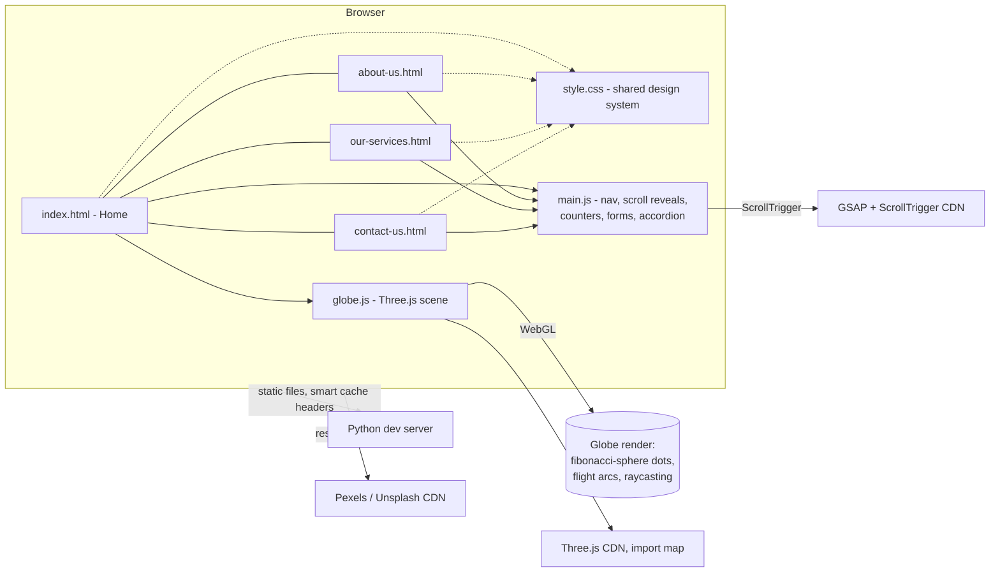

# ✈️ Travel Agency Website — Immersive Travel Site

> A four-page marketing site for a travel agency, built around an interactive 3D globe hero and scroll-driven storytelling — designed to feel more like a premium interactive experience than a template.

**Status:** Private repository — source code available on request (interviews, review, collaboration).

---

## What it does

A website for a travel agency, spread across four pages — **Home, About Us, Our Services, Contact Us** — with an emphasis on interactivity and motion rather than a static brochure feel:

- A **rotating 3D globe** as the homepage hero, built in Three.js: glowing flight arcs animate from the agency's home base out to each of their 12+ destinations, with hoverable pins (raycasting) that show a destination tooltip and a subtle mouse-parallax tilt on the whole globe.
- **Scroll-driven storytelling** throughout: parallax image layers, count-up statistics, a milestone timeline whose progress line fills as you scroll past it, and a nav bar that swaps between light/dark text depending on what's behind it.
- An **interactive destination browser** — a native-feel drag/swipe rail on the homepage, and a 10-region accordion on the Services page covering the agency's full route list.
- A **working enquiry form** (name/phone/email/message) with client-side validation that composes a pre-filled email to the agency — no backend required.
- Fully responsive: a real mobile navigation menu (not just a shrunk desktop layout), touch-native scrolling, and a Three.js scene that scales its complexity down on small screens.

---

## Tech stack

**Frontend**
- Vanilla HTML/CSS/JS — no framework, no build step, ES modules loaded directly by the browser
- **Three.js** (via CDN import map) for the WebGL globe scene
- **GSAP + ScrollTrigger** for scroll-linked animation and parallax
- Google Fonts (Fraunces for display type, Inter for body)

**Tooling / dev environment**
- A small custom **Python dev server** (`ThreadingHTTPServer` + tuned `Cache-Control` policy) for local and same-network mobile testing
- Free stock photography (Pexels/Unsplash), served through their CDN's on-the-fly resize/compress parameters rather than committing or hotlinking full-resolution originals

---

## Architecture

---

## Key engineering decisions

- **No build step, on purpose.** Four static HTML pages sharing one stylesheet and one script file, with Three.js loaded via a native `<script type="importmap">` — modern module syntax without bringing in a bundler for what is fundamentally a marketing site.
- **Hand-built globe visualization**, not a plugin: destination points are placed with a Fibonacci-sphere distribution for even coverage, flight paths are `QuadraticBezierCurve3` arcs lifted above the sphere surface with an animated traveling dot, and pin hover detection uses a raycaster projected against pointer position — all handled with performance guards (reduced point/segment counts and capped device pixel ratio on small screens, render loop paused via `IntersectionObserver`/`visibilitychange` when the canvas is off-screen or the tab is hidden).
- **A section-driven nav theming system** that took two iterations to get right: the first version tried to infer the nav's light/dark state by guessing "the opposite of whatever section I'm leaving," which broke whenever two adjacent sections shared the same theme. The fix was to make every section explicitly own the nav's theme the moment it's scrolled into — simpler and provably correct in both scroll directions.
- **Tracked down a classic CSS trap**: the mobile full-screen menu was rendering squashed into the header bar instead of covering the viewport. Root cause was `backdrop-filter` on the scrolled nav bar — a property that (like `transform`/`filter`/`perspective`/`will-change`) makes an element a *containing block* for `position: fixed` descendants, silently breaking the menu's `inset: 0` full-screen positioning.
- **Image payload discipline**: hotlinked stock photos are requested through Pexels' resize/compress query parameters sized to their actual display context (hero backgrounds vs. small cards), cutting a typical image from ~2.8 MB down to ~200 KB rather than shipping full-resolution originals to a mobile viewport.
- **A dev server tuned from real debugging pain**: switched from Python's default single-threaded server to `ThreadingHTTPServer` with a deliberate cache policy (long-cache for version-stamped assets, `no-store` for HTML) after diagnosing multi-layered caching issues across a local proxy and mobile browsers during iterative development.

---

## Interested in the code?

The repository is private. If you'd like to see the source — the globe implementation, the animation system, or a live walkthrough — feel free to reach out.
